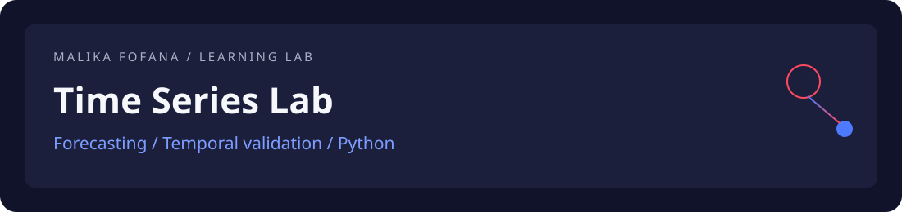

# Time Series Lab

**Python · Pandas · Statsmodels · Prophet · Validation temporelle**

Dépôt d’entraînement aux séries temporelles dans mon parcours AI & Data Engineering. Il rassemble les supports et exercices du cours **Python for Time Series Forecasting**, de **Jesus Lopez**, sur LinkedIn Learning.

[Parcours](#parcours) · [Exécution](#exécution-locale) · [Méthode](#méthode-de-lecture) · [Crédits](#crédits-et-support-original)

## Parcours

| Bloc | Compétences travaillées | Accès |
| --- | --- | --- |
| Fondations | Préparation, visualisation et décomposition des séries | [1_Foundation](notebooks/1_Foundation) |
| Modélisation | Stationnarité, ARIMA, SARIMA, lissage et Prophet | [2_Modelling](notebooks/2_Modelling) |
| Validation | Découpage temporel et validation walk-forward | [3_Validation](notebooks/3_Validation) |

Les données présentes dans [data](data) comprennent notamment des séries EIA, FRED et UCI Irvine. Les consignes et hypothèses de chaque notebook restent la référence pour son exécution.

## Exécution locale

```bash
git clone https://github.com/malikafofana/timeseriesentrainement1.git
cd timeseriesentrainement1
python -m venv .venv
source .venv/bin/activate
python -m pip install -r requirements.txt
```

Sur Windows, activer l’environnement avec `.venv\Scripts\Activate.ps1`. Ouvrir ensuite un notebook dans un éditeur compatible Jupyter et sélectionner cet environnement Python. Une configuration Codespaces est également fournie dans le dépôt.

## Méthode de lecture

1. Observer la fréquence, les valeurs manquantes, la tendance et la saisonnalité.
2. Respecter l’ordre chronologique pour séparer apprentissage et validation.
3. Comparer les modèles sur une fenêtre de validation commune.
4. Examiner les erreurs avant d’interpréter les prévisions.

Ce dépôt est présenté comme un support d’apprentissage : il ne revendique pas un benchmark personnel validé, des performances en production ou l’écriture originale des supports de cours. Les dépendances du cours ne sont pas toutes figées ; leur compatibilité dépend de l’environnement utilisé.

## Crédits et support original

Cours : **Jesus Lopez / LinkedIn Learning**. Les mentions, licences et fichiers d’origine sont conservés.

<details>
<summary>Consulter la présentation originale du cours</summary>

# Python for Time Series Forecasting

Welcome to the repository for the LinkedIn Learning course **Python for Time Series Forecasting** by Jesus Lopez. The full course is available on [LinkedIn Learning](https://www.linkedin.com/learning/).


## Course Overview
Many business forecasts miss the mark, wasting millions through over- or under-planning. Without the right tools and a mental framework for understanding time series, predictions can easily lead to costly mistakes. In this course, you'll master forecasting with step-by-step guidance in Python, learning theory exactly when you need it so you can put it into practice.

You'll work with real datasets from the US Energy Administration and Federal Reserve, learning to:
* Load, pre-process, and visualize time series data
* Build and validate ARIMA, SARIMA, exponential smoothing, and Prophet models
* Use train/test split and walk-forward validation to trust your forecasts and plan for the future

Ready to forecast like a pro? Join Jesús López and turn raw data into future-proof forecasts.

## Getting Started

### Using Codespaces (Recommended)
This course is designed to be run in a GitHub Codespace, a virtual computer with all required Python packages pre-installed. To get started:
1. Click the **Code** button in GitHub and select **Create codespace on main**.
2. Wait for the Codespace to finish setting up. You can monitor progress by clicking the bell icon in the Codespace interface.
3. Once setup is complete, activate the **VS Code Icons** extension for a better folder view (optional).

### Repository Structure
All course notebooks are in the `notebooks` folder, organized into three main blocks:
* **1_Foundation**: Loading, pre-processing, and decomposition of time series data
* **2_Modelling**: Building models (ARIMA, SARIMA, smoothing, Prophet), understanding stationarity, and evaluating models
* **3_Validation**: Simulating real-world scenarios with rolling window validation

Inside each folder, you'll find Jupyter notebooks with code ready to run. To execute code cells, select a Python environment (e.g., `global env`) when prompted, then use `Shift+Enter` to run each cell.

### Assignments
Each block contains an assignment notebook. These follow a template approach: substitute the UPPERCASE variables with your chosen data and follow the steps to validate your results and forecast into the future.

## Requirements
All requirements are pre-installed in Codespaces. If running locally, install dependencies from `requirements.txt`.

## Cloning the Repository
To work locally:
1. Clone this repository:
    git clone <repo-url>
2. Install requirements:
    pip install -r requirements.txt
3. Open the `notebooks` folder and start exploring!

---

Happy forecasting!

</details>

---

[Profil de Malika Fofana](https://github.com/malikafofana) · [Telco Signal](https://github.com/malikafofana/telco-signal) · [Evidence Search](https://github.com/malikafofana/evidence-search) · [Alzheimer MRI Study](https://github.com/malikafofana/alzheimer-mri-study)
